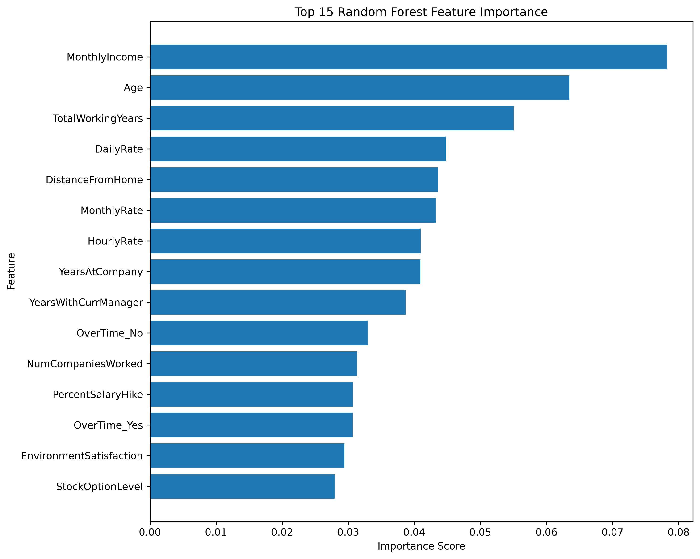
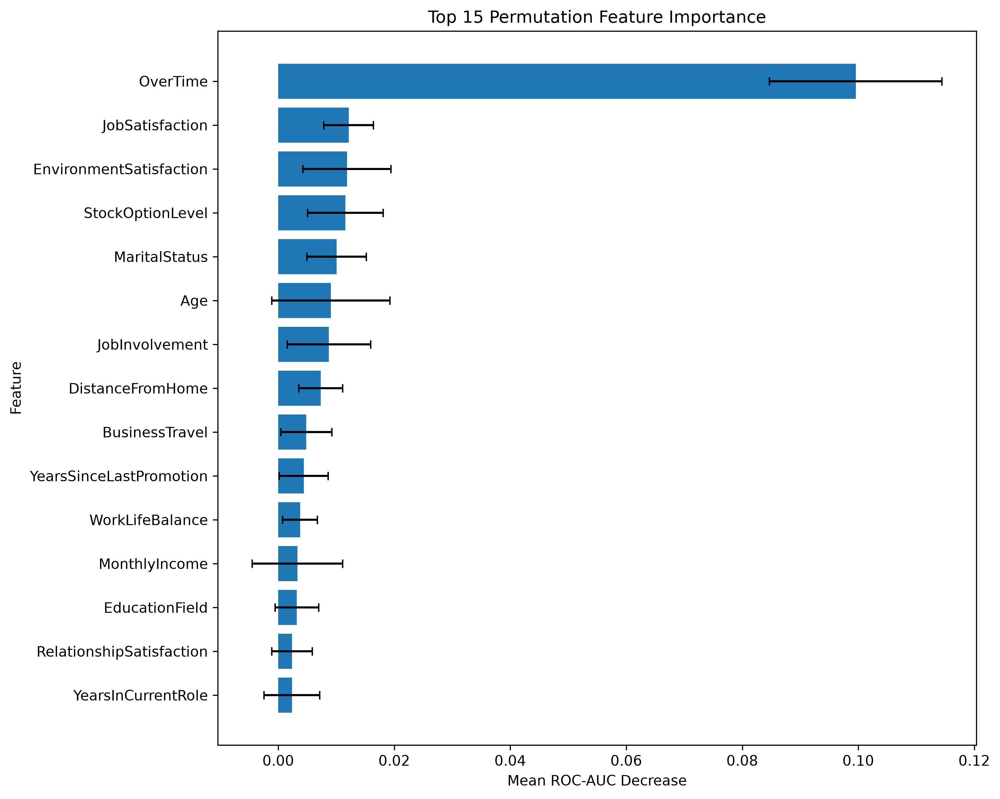
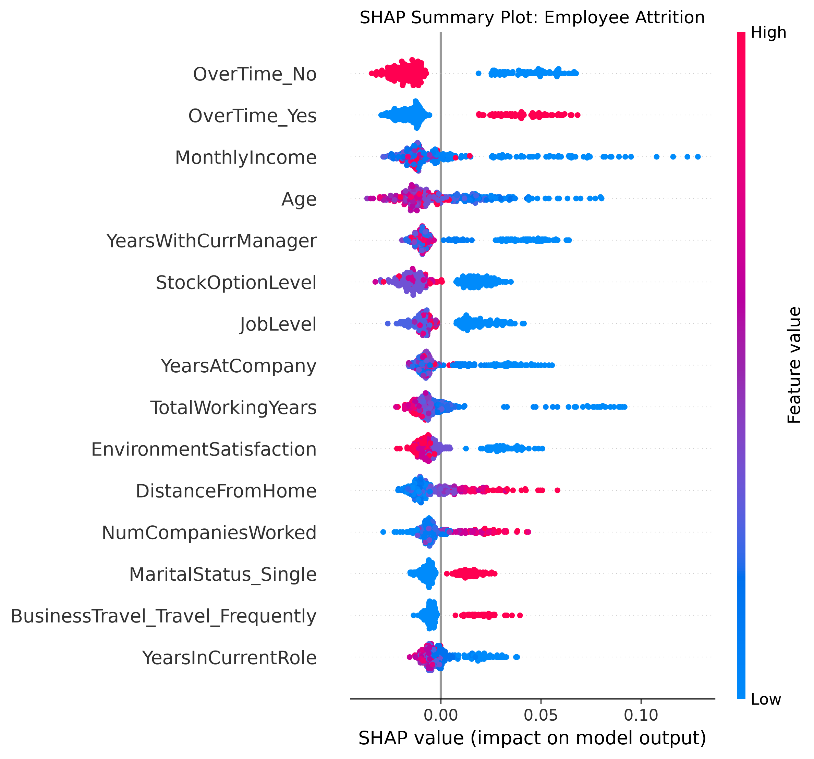
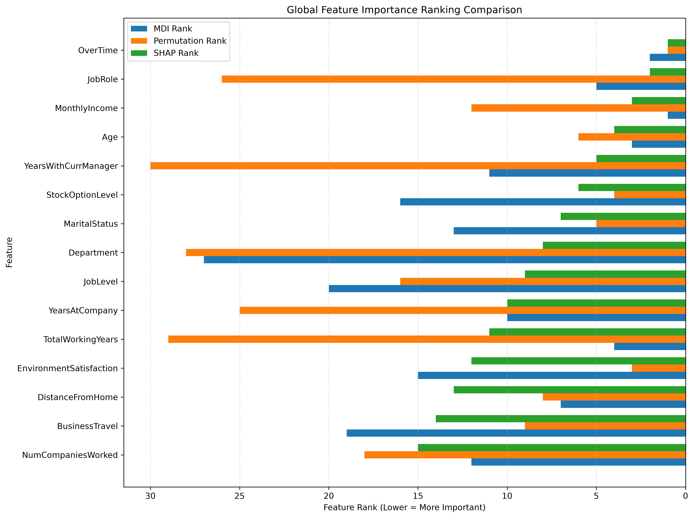
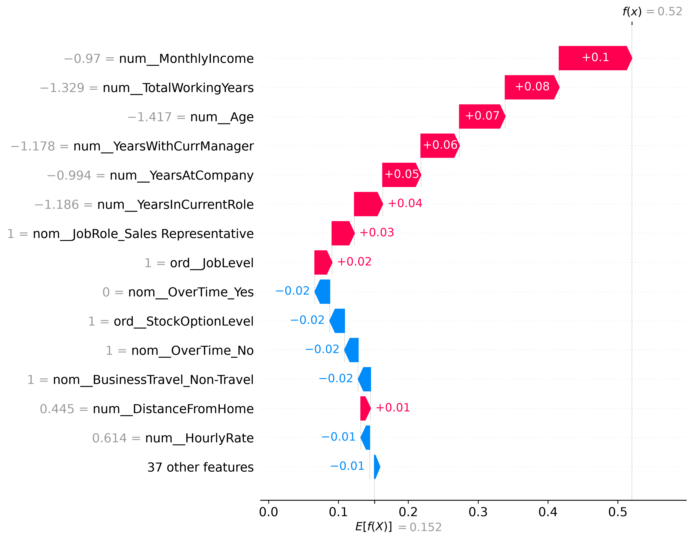

# WorkforceIQ

## Employee Attrition Prediction and Analytics

WorkforceIQ is an end-to-end machine learning project designed to predict employee attrition and analyze factors associated with employees leaving an organization.

The project focuses on building classification models, identifying relevant employee patterns, evaluating model performance, interpreting model predictions, and developing an interactive analytics application.

## Objectives

- Build and compare multiple classification models.
- Identify factors associated with employee attrition.
- Evaluate model performance using appropriate classification metrics.
- Develop a reusable prediction pipeline.
- Interpret model predictions using explainability techniques.
- Build an interactive analytics dashboard.
- Deploy the application using containerization.

## Technology Stack

- Python
- pandas and NumPy
- scikit-learn
- Matplotlib and Seaborn
- SHAP
- MLflow
- FastAPI
- Streamlit
- pytest
- Docker
- Docker Compose
- Git and GitHub

## Project Structure

```text
WorkforceIQ/
├── data/
│   ├── raw/
│   └── processed/
├── notebooks/
├── src/
│   ├── __init__.py
│   ├── data_loader.py
│   ├── inspection/
│   ├── analysis/
│   │   ├── attrition_distribution.py
│   │   ├── numerical_distribution.py
│   │   ├── numerical_vs_attrition.py
│   │   ├── categorical_distribution.py
│   │   ├── categorical_vs_attrition.py
│   │   ├── correlation_analysis.py
│   │   ├── generate_eda_report.py
│   │   ├── analyze_feature_importance.py
│   │   ├── plot_feature_importance.py
│   │   ├── analyze_permutation_importance.py
│   │   ├── plot_permutation_importance.py
│   │   ├── analyze_shap.py
│   │   ├── plot_shap_summary.py
│   │   ├── plot_shap_waterfall.py
│   │   ├── compare_feature_importance.py
│   │   ├── plot_global_feature_importance.py
│   │   ├── predict_employee.py
│   │   └── explain_employee.py
│   ├── preprocessing/
│   ├── pipeline/
│   │   └── build_pipeline.py
│   └── api/
│       ├── main.py
│       └── prediction.py
├── frontend/
│   └── app.py
├── models/
│   └── workforceiq_pipeline.joblib
├── reports/
│   ├── figures/
│   ├── dataset_profile.txt
│   ├── eda_summary.txt
│   ├── preprocessing_summary.txt
│   ├── model_evaluation_report.md
│   ├── explainability_report.md
│   ├── random_forest_feature_importance.csv
│   ├── permutation_importance.csv
│   ├── shap_values.csv
│   └── global_feature_importance_comparison.csv
├── tests/
├── Dockerfile
├── Dockerfile.frontend
├── docker-compose.yml
├── .dockerignore
├── .gitignore
├── requirements.txt
└── README.md
```

## Dataset

### IBM HR Analytics Employee Attrition & Performance Dataset

- Records: 1,470 employees
- Features: 35 columns
- Target variable: `Attrition`
- Target classes: `Yes` and `No`

Dataset source: [IBM HR Analytics Employee Attrition Dataset - Kaggle](https://www.kaggle.com/datasets/pavansubhasht/ibm-hr-analytics-attrition-dataset)

The raw dataset is maintained locally and excluded from Git tracking.

## Current Progress

### Phase 1: Project Setup

- Project structure created.
- Python virtual environment configured.
- Dependencies installed.
- Git and GitHub repository configured.

### Phase 2: Dataset Loading and Understanding

- IBM HR Analytics dataset loaded.
- Dataset structure and data types inspected.
- Missing values and duplicate records analyzed.
- Numerical and categorical features inspected.
- Dataset profile report generated.

### Phase 3: Exploratory Data Analysis (EDA)

- Employee attrition distribution analyzed.
- Numerical feature distributions visualized.
- Numerical features compared against attrition.
- Categorical feature distributions analyzed.
- Categorical attrition rates calculated.
- Correlation matrix and heatmap generated.
- EDA summary report generated.
- Six EDA visualizations saved for documentation.

### Phase 4: Data Preprocessing & Feature Engineering

- Administrative and identifier features excluded.
- Predictor features classified into numerical, ordinal, and nominal categories.
- Target variable encoded into binary values.
- Stratified train-test split implemented.
- Numerical scaling and nominal encoding implemented.
- Reusable `ColumnTransformer` constructed.
- Preprocessing integrated with classifiers through `Pipeline`.
- Transformed datasets validated.
- Initial class imbalance strategy established.

### Phase 5: Model Development & Evaluation

- Logistic Regression, Decision Tree, Random Forest, and Gradient Boosting evaluated.
- Baseline model evaluation completed.
- Stratified 5-fold cross-validation performed.
- Hyperparameter tuning using GridSearchCV completed.
- Out-of-fold probability generation implemented.
- F1-based classification threshold optimization completed.
- Held-out test evaluation performed at default and optimized thresholds.
- Random Forest selected as the final candidate model.

### Phase 6: Explainability & Model Interpretation

- Random Forest feature importance analyzed using Mean Decrease in Impurity (MDI).
- Permutation importance calculated using ROC-AUC scoring.
- SHAP values generated for global model interpretation.
- SHAP summary and waterfall visualizations generated.
- Global feature importance compared across MDI, permutation importance, and SHAP.
- Original feature importance aggregated from transformed features.
- Individual employee attrition predictions generated.
- Individual employee SHAP explanations implemented.
- SHAP additivity validated against predicted probabilities.
- Explainability report generated with findings, visualizations, and limitations.

## Exploratory Data Analysis

### 1. Employee Attrition Distribution

The dataset contains an imbalanced target variable:

- Employees who stayed: 1,233 (83.88%)
- Employees who left: 237 (16.12%)


### 2. Numerical Feature Distributions

Histograms are used to understand the distribution of numerical employee features.


### 3. Numerical Features vs Attrition

Boxplots compare numerical feature distributions between employees who stayed and employees who left.


### 4. Categorical Feature Distributions

Category counts provide an overview of employee distribution across departments, job roles, travel patterns, and other categorical features.


### 5. Categorical Features vs Attrition

Category-wise attrition rates help identify employee groups with different attrition patterns.


### 6. Feature Correlation Analysis

The Pearson correlation heatmap highlights relationships between numerical features and their association with attrition.


## Key EDA Findings

- The dataset has an attrition rate of 16.12%.
- Employees who left generally have lower median monthly income and shorter company tenure.
- Employees working overtime show a higher attrition rate.
- Sales Representatives show relatively high attrition.
- Single employees show higher attrition than married employees.
- Several experience-related and income-related features are strongly correlated.

These findings represent statistical associations within the dataset and do not establish causal relationships.

## Phase 4: Preprocessing Summary

### Feature Selection

Excluded administrative and identifier columns:

- EmployeeNumber
- EmployeeCount
- Over18
- StandardHours

Retained 30 predictor features.

### Feature Classification

| Feature Type | Count |
|---|---:|
| Numerical | 14 |
| Ordinal | 9 |
| Nominal | 7 |
| Total | 30 |

### Train-Test Split

- Training samples: 1,176 (80%)
- Testing samples: 294 (20%)
- Random state: 42
- Stratification: Enabled

The original attrition distribution was preserved across both subsets.

### Preprocessing Strategy

| Feature Type | Transformation |
|---|---|
| Numerical | StandardScaler |
| Nominal | OneHotEncoder |
| Ordinal | Passthrough |

## Phase 5: Model Development & Evaluation

### Models Evaluated

- Logistic Regression
- Decision Tree
- Random Forest
- Gradient Boosting

### Evaluation Workflow

- Baseline model evaluation using classification metrics.
- Stratified 5-fold cross-validation.
- Hyperparameter tuning using GridSearchCV.
- Out-of-fold probability generation.
- F1-based classification threshold optimization.
- Held-out test evaluation at default and optimized thresholds.

### Final Candidate Model

| Metric | Value |
|---|---:|
| Model | Random Forest |
| Optimized Threshold | 0.2400 |
| Test ROC-AUC | 0.8046 |
| Test Precision | 44.62% |
| Test Recall | 61.70% |
| Test F1-score | 51.79% |
| Test Accuracy | 81.63% |

Random Forest with the optimized threshold demonstrated improved attrition detection compared with the default threshold of 0.50.

### Evaluation Report

Detailed evaluation results, cross-validation analysis, tuning results, threshold optimization, and model selection rationale are available in:

`reports/model_evaluation_report.md`

## Phase 6: Explainability & Model Interpretation

### 1. Random Forest Feature Importance

Mean Decrease in Impurity (MDI) was used to analyze feature importance within the trained Random Forest.



### 2. Permutation Importance

Permutation importance evaluates the impact of feature shuffling on model ROC-AUC.



OverTime emerged as the strongest predictive signal according to permutation importance.

### 3. SHAP Explainability

SHAP values were used to interpret global feature contributions and individual employee predictions.



### 4. Global Attrition Drivers

Feature importance rankings were compared across MDI, permutation importance, and SHAP.



Key observations:

- OverTime consistently appeared as a strong predictive signal.
- MonthlyIncome and Age were prominent in MDI and SHAP.
- StockOptionLevel and MaritalStatus showed relatively high permutation and SHAP importance.
- JobRole showed substantial SHAP contributions but comparatively low permutation importance.

Different importance methods measure different aspects of model behavior, so their rankings are not expected to match exactly.

### 5. Individual Employee Explanation

An employee from the test dataset was selected for individual prediction and explanation.

| Attribute | Value |
|---|---:|
| Actual Attrition | No |
| Predicted Attrition | Yes |
| Attrition Probability | 0.5200 |
| Classification Threshold | 0.2400 |
| Prediction Outcome | False Positive |



The SHAP waterfall explains how individual feature contributions move the predicted probability away from the baseline.

The individual SHAP explanation approximately reconstructed the predicted probability, with an additivity difference of 0.0002.

### 6. Explainability Report

The detailed explainability analysis, global feature comparisons, individual employee explanation, and limitations are documented in:

`reports/explainability_report.md`

## Explainability Limitations

- Feature importance does not establish causal relationships.
- SHAP values describe model behavior rather than employee motivations.
- Correlated features can distribute importance across multiple features.
- Permutation importance depends on the evaluation dataset and metric.
- Individual explanations represent specific observations and are not necessarily representative of all employees.
- Attrition predictions should not be treated as definitive judgments about individual employees.
- Dataset patterns may not generalize to every organization.

## Running the Project

Run commands from the project root directory with the virtual environment activated.

### Dataset Inspection

```bash
python -m src.inspection.inspect_dataset
python -m src.inspection.inspect_target
python -m src.inspection.inspect_data_quality
```

Generate the dataset profile:

```bash
python -m src.inspection.generate_dataset_report
```

### Exploratory Data Analysis

Run individual analysis modules:

```bash
python -m src.analysis.attrition_distribution
python -m src.analysis.numerical_distribution
python -m src.analysis.numerical_vs_attrition
python -m src.analysis.categorical_distribution
python -m src.analysis.categorical_vs_attrition
python -m src.analysis.correlation_analysis
```

Generate the EDA summary report:

```bash
python -m src.analysis.generate_eda_report
```

### Data Preprocessing

Execute the stratified train-test split:

```bash
python -m src.preprocessing.split_data
```

The preprocessing components can also be imported and reused programmatically:

```python
from src.preprocessing.prepare_features import prepare_features
from src.preprocessing.build_preprocessor import build_preprocessor
from src.pipeline.build_pipeline import build_pipeline
```

The preprocessing pipeline is designed to fit transformations using training data only and apply the same transformations to unseen data.

### Model Explainability

Run Random Forest feature importance analysis:

```bash
python -m src.analysis.analyze_feature_importance
python -m src.analysis.plot_feature_importance
```

Run permutation importance analysis:

```bash
python -m src.analysis.analyze_permutation_importance
python -m src.analysis.plot_permutation_importance
```

Run SHAP analysis:

```bash
python -m src.analysis.analyze_shap
python -m src.analysis.plot_shap_summary
python -m src.analysis.plot_shap_waterfall
```

Compare global feature importance:

```bash
python -m src.analysis.compare_feature_importance
python -m src.analysis.plot_global_feature_importance
```

Generate an individual employee prediction:

```bash
python -m src.analysis.predict_employee
```

Generate an individual employee SHAP explanation:

```bash
python -m src.analysis.explain_employee
```

## Phase 7: Deployment & Application

### Deployment Architecture

WorkforceIQ uses a separate frontend and backend architecture:

- **Backend:** FastAPI
- **Frontend:** Streamlit
- **ML Pipeline:** Scikit-learn preprocessing and Random Forest
- **Model Artifact:** `models/workforceiq_pipeline.joblib`
- **API Communication:** HTTP requests using the Requests library

### Application Features

- Employee information form with 30 predictor features
- Real-time attrition prediction
- Attrition probability visualization
- Low, Moderate, and High risk categorization
- Classification threshold display
- Employee profile summary
- Risk interpretation and responsible-use guidance
- API error handling and input validation

### API Endpoints

| Method | Endpoint | Description |
|---|---|---|
| GET | `/` | API information |
| GET | `/health` | API health check |
| POST | `/predict` | Employee attrition prediction |

Interactive API documentation is available at `/docs`.

### Model Deployment

- Tuned Random Forest trained on the complete dataset
- Classification threshold: 0.24
- Model and preprocessing pipeline serialized using Joblib

### Testing

- API health verification
- Valid prediction request
- Invalid categorical input validation
- Classification threshold unit tests
- Streamlit and FastAPI integration
- API connection failure handling

Threshold classification tests: **3 passed**

## Phase 8: Docker Deployment

### Docker Architecture

WorkforceIQ is containerized using Docker:

- FastAPI backend container
- Streamlit frontend container
- Docker Compose orchestration
- Internal Docker networking for frontend-backend communication
- FastAPI health endpoint for API health verification
- Container restart policies for service recovery

### Docker Deployment

Build and start the application:

```bash
docker compose up --build -d
```

Application URLs:

| Component | URL |
|---|---|
| Streamlit Dashboard | http://localhost:8501 |
| FastAPI Backend | http://localhost:8000 |
| API Documentation | http://localhost:8000/docs |
| API Health | http://localhost:8000/health |

### Container Management

Check container status:

```bash
docker compose ps
```

View application logs:

```bash
docker compose logs -f
```

Stop the application:

```bash
docker compose down
```

### Docker Validation

- API container startup verified.
- API health endpoint verified.
- Frontend container startup verified.
- Docker networking validated.
- Dashboard prediction verified.
- Containerized prediction output validated.
- API connection between containers verified.

## Phase 9: Cloud Deployment

### Deployment Platform

WorkforceIQ is successfully deployed on Render.

### Deployment Architecture

The cloud deployment consists of two independent services:

- **Backend Service:** FastAPI prediction API deployed using the backend Dockerfile.
- **Frontend Service:** Streamlit dashboard deployed using the frontend Dockerfile.
- **Communication:** Streamlit communicates with the deployed FastAPI service through the `API_URL` environment variable.
- **Model Artifact:** The trained Random Forest pipeline is loaded by the backend during startup.
- **Infrastructure:** Both services are containerized and deployed independently on Render.

### Deployment Workflow

- Dockerfiles configured for Render deployment.
- Backend and frontend deployment configurations completed.
- FastAPI backend deployed and health verified.
- Streamlit frontend deployed successfully.
- Frontend-backend API integration verified.
- Cloud prediction workflow validated successfully.
- Live employee attrition prediction verified through the deployed dashboard.

## Live Deployment

WorkforceIQ is deployed on Render.

| Service | URL |
|---|---|
| Streamlit Dashboard | https://workforceiq-frontend.onrender.com |
| FastAPI Backend | https://workforceiq-api-prod.onrender.com |
| API Documentation | https://workforceiq-api-prod.onrender.com/docs |
| Health Check | https://workforceiq-api-prod.onrender.com/health |

### Production Validation

The deployed application was successfully validated.

| Component | Status |
|---|---|
| FastAPI Backend | Healthy |
| Model Loading | Verified |
| Streamlit Frontend | Live |
| API Integration | Working |
| Cloud Prediction | Successful |

### Live Prediction Example

A sample employee prediction was successfully generated through the deployed dashboard.

| Attribute | Result |
|---|---|
| Prediction | Likely to Stay |
| Attrition Probability | 8.79% |
| Risk Level | Low |
| Classification Threshold | 24% |
| Model | Random Forest |

The prediction was classified as *Likely to Stay* because the estimated attrition probability was below the configured classification threshold.

### Deployment Notes

- Render free-tier services may spin down after inactivity, resulting in cold-start delays.
- The first API request after inactivity may take longer than subsequent requests.
- The application uses the configured classification threshold of 0.24.
- Predictions represent model estimates and should not be interpreted as definitive employee outcomes.


## Future Development

- Complete cloud deployment using Render.
- Production deployment validation.
- Continuous integration and deployment.
- Application monitoring and logging.
- Further model performance improvements.
- Additional prediction analytics and visualizations.

## Responsible Use

WorkforceIQ is an educational machine learning project intended for employee attrition analysis.

Predictions represent statistical patterns learned from historical data and should not be used as the sole basis for employment decisions.

The model does not establish causality or determine employee intent. Its predictions should be interpreted carefully, with consideration of dataset limitations, potential bias, and organizational context.
