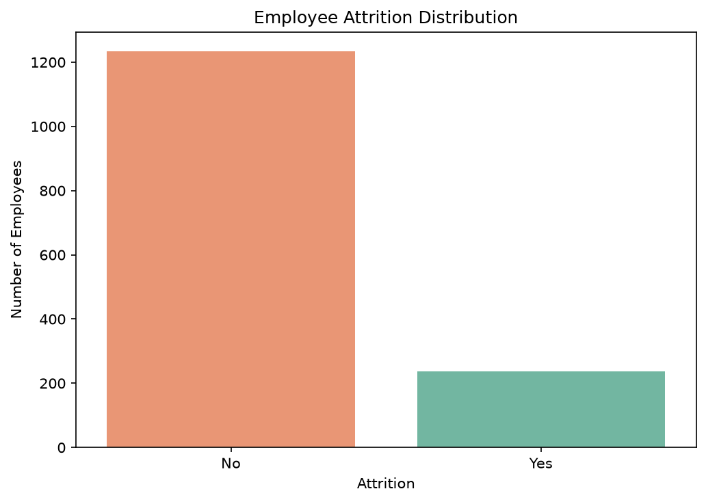
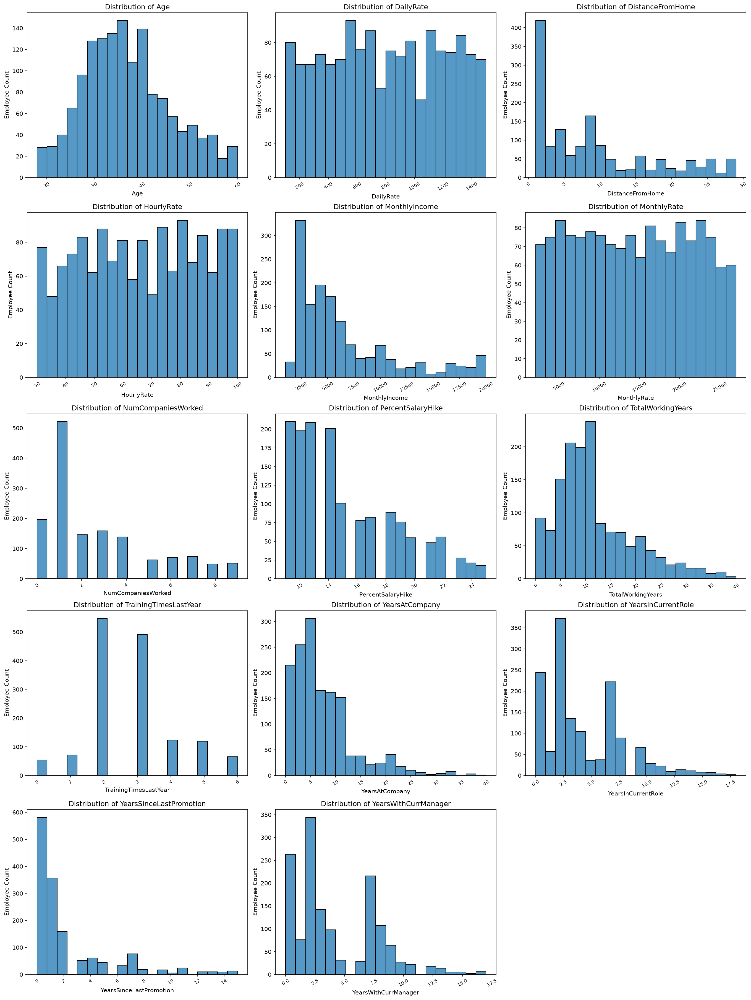
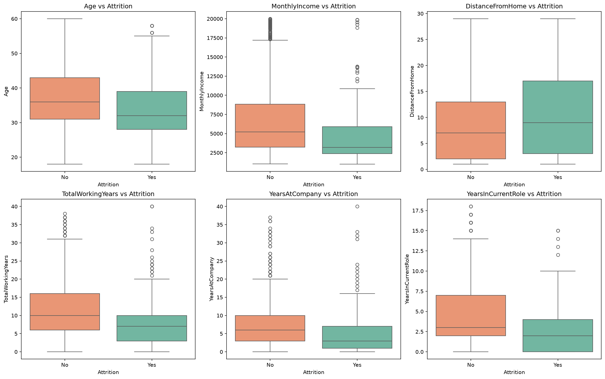
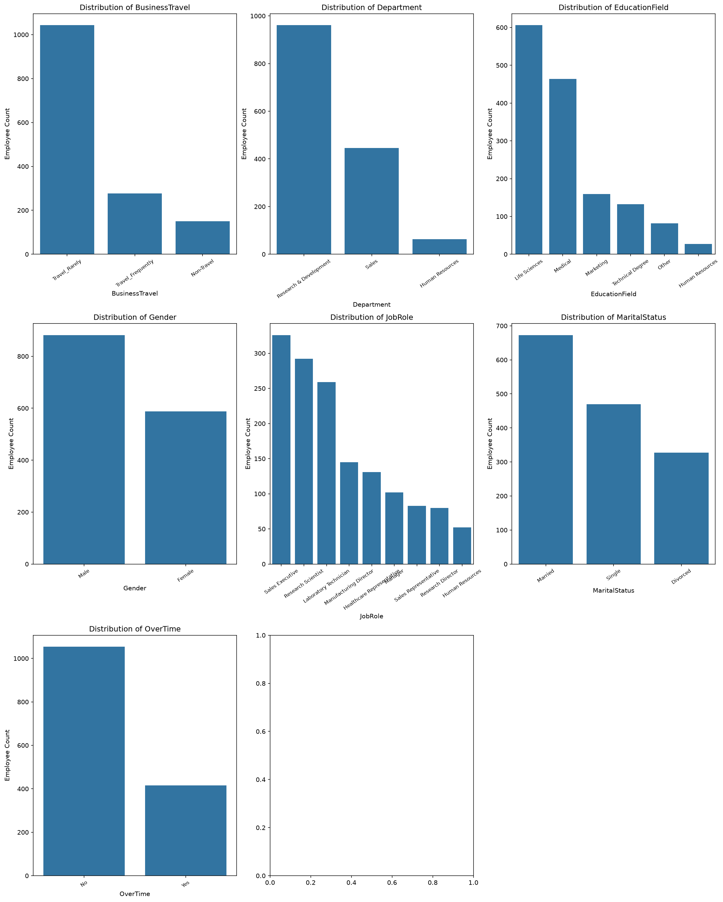
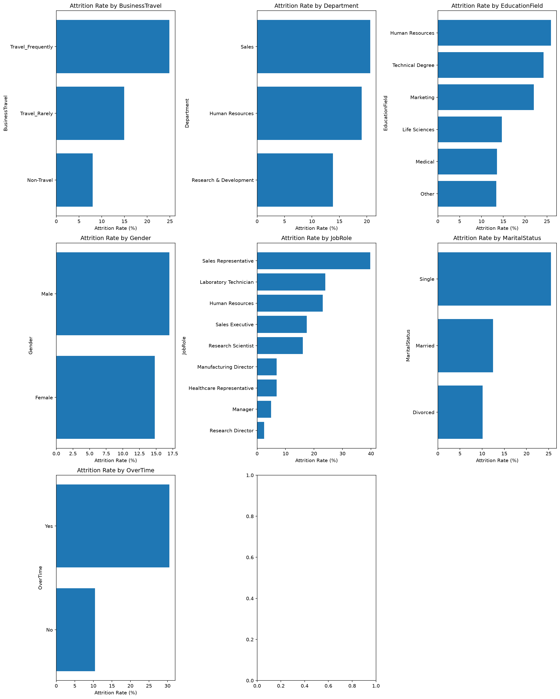
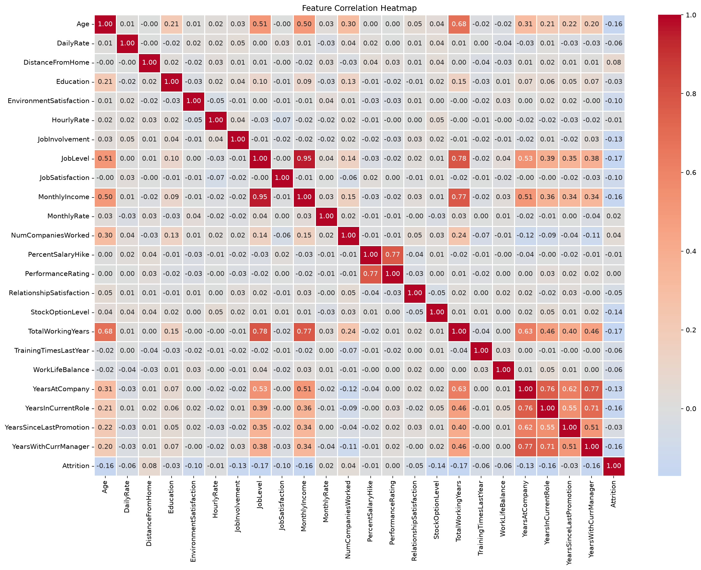

# WorkforceIQ
## Employee Attrition Prediction and Analytics

WorkforceIQ is an end-to-end machine learning project designed to predict employee attrition and analyze factors associated with employees leaving an organization.

The project focuses on building classification models, identifying relevant employee patterns, evaluating model performance, and developing an interactive analytics application.

## Objectives

- Build and compare multiple classification models.
- Identify factors associated with employee attrition.
- Evaluate model performance using appropriate classification metrics.
- Develop a reusable prediction pipeline.
- Build an interactive analytics dashboard.

## Technology Stack

- Python
- pandas and NumPy
- scikit-learn
- Matplotlib and Seaborn
- MLflow
- FastAPI
- Streamlit
- pytest
- Docker

## Project Structure

```text
WorkforceIQ/
├── data/
│   ├── raw/
│   └── processed/
├── notebooks/
├── src/
│   ├── __init__.py
│   ├── data_loader.py
│   ├── inspection/
│   │   ├── __init__.py
│   │   ├── inspect_dataset.py
│   │   ├── inspect_target.py
│   │   ├── inspect_data_quality.py
│   │   ├── inspect_features.py
│   │   ├── inspect_statistics.py
│   │   ├── inspect_categories.py
│   │   ├── inspect_variance.py
│   │   ├── inspect_identifiers.py
│   │   └── generate_dataset_report.py
│   └── analysis/
│       ├── __init__.py
│       ├── attrition_distribution.py
│       ├── numerical_distribution.py
│       ├── numerical_vs_attrition.py
│       ├── categorical_distribution.py
│       ├── categorical_vs_attrition.py
│       ├── correlation_analysis.py
│       └── generate_eda_report.py
├── models/
├── reports/
│   ├── figures/
│   ├── dataset_profile.txt
│   └── eda_summary.txt
├── tests/
├── .gitignore
├── requirements.txt
└── README.md
```

### Planned Architecture

The following components will be introduced in upcoming development phases:

```text
src/
├── preprocessing/    # Phase 4
├── models/           # Phase 5
├── pipeline/         # Phase 8
└── api/              # Phase 8
```

## Dataset

**IBM HR Analytics Employee Attrition & Performance Dataset**

- Records: 1,470 employees
- Features: 35 columns
- Target variable: `Attrition`
- Target classes: `Yes` and `No`

Dataset source: [IBM HR Analytics Employee Attrition Dataset - Kaggle](https://www.kaggle.com/datasets/pavansubhasht/ibm-hr-analytics-attrition-dataset)

The raw dataset is maintained locally and excluded from Git tracking.

## Current Progress

### Phase 1: Project Setup
- Project structure created.
- Python virtual environment configured.
- Dependencies installed.
- Git and GitHub repository configured.

### Phase 2: Dataset Loading and Understanding
- IBM HR Analytics dataset loaded.
- Dataset structure and data types inspected.
- Missing values and duplicate records analyzed.
- Numerical and categorical features inspected.
- Dataset profile report generated.

### Phase 3: Exploratory Data Analysis (EDA)
- Employee attrition distribution analyzed.
- Numerical feature distributions visualized.
- Numerical features compared against attrition.
- Categorical feature distributions analyzed.
- Categorical attrition rates calculated.
- Correlation matrix and heatmap generated.
- EDA summary report generated.
- Six EDA visualizations saved for documentation.

## Exploratory Data Analysis

### 1. Employee Attrition Distribution

The dataset contains an imbalanced target variable:

- Employees who stayed: 1,233 (83.88%)
- Employees who left: 237 (16.12%)



### 2. Numerical Feature Distributions

Histograms are used to understand the distribution of numerical employee features.



### 3. Numerical Features vs Attrition

Boxplots compare numerical feature distributions between employees who stayed and employees who left.



### 4. Categorical Feature Distributions

Category counts provide an overview of employee distribution across departments, job roles, travel patterns, and other categorical features.



### 5. Categorical Features vs Attrition

Category-wise attrition rates help identify employee groups with different attrition patterns.



### 6. Feature Correlation Analysis

The Pearson correlation heatmap highlights relationships between numerical features and their association with attrition.



## Key EDA Findings

- The dataset has an attrition rate of 16.12%.
- Employees who left generally have lower median monthly income and shorter company tenure.
- Employees working overtime show a higher attrition rate.
- Sales Representatives show relatively high attrition.
- Single employees show higher attrition than married employees.
- Several experience-related and income-related features are strongly correlated.

These findings represent statistical associations within the dataset and do not establish causal relationships.

## Running the Project

Run commands from the project root directory.

### Dataset Inspection

```bash
python -m src.inspection.inspect_dataset
python -m src.inspection.inspect_target
python -m src.inspection.inspect_data_quality
```

Generate the dataset profile:

```bash
python -m src.inspection.generate_dataset_report
```

### Exploratory Data Analysis

Run individual analysis modules:

```bash
python -m src.analysis.attrition_distribution
python -m src.analysis.numerical_distribution
python -m src.analysis.numerical_vs_attrition
python -m src.analysis.categorical_distribution
python -m src.analysis.categorical_vs_attrition
python -m src.analysis.correlation_analysis
```

Generate the EDA summary report:

```bash
python -m src.analysis.generate_eda_report
```

## Planned Models

- Logistic Regression
- Decision Tree Classifier
- Random Forest Classifier
- Gradient Boosting Classifier

## Modeling Considerations

- Use stratified train-test splitting to preserve class distribution.
- Evaluate models using precision, recall, F1-score, confusion matrix, and ROC-AUC alongside accuracy.
- Fit preprocessing operations using training data only.
- Investigate class imbalance and feature relationships during model development.
- Compare models using consistent evaluation procedures.

## Future Development

- Data preprocessing and feature engineering.
- Classification model development and comparison.
- Hyperparameter tuning and cross-validation.
- Feature importance and model explainability.
- Reusable prediction pipeline.
- FastAPI backend.
- Streamlit analytics dashboard.
- MLflow experiment tracking.
- Automated testing and Docker deployment.

## Disclaimer

This project is intended for educational and analytical purposes. Predictions should not be used as the sole basis for employment decisions.