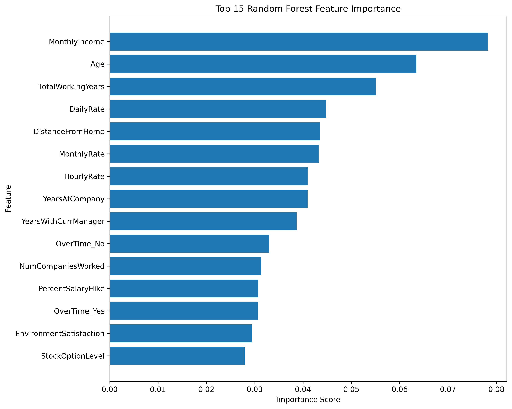
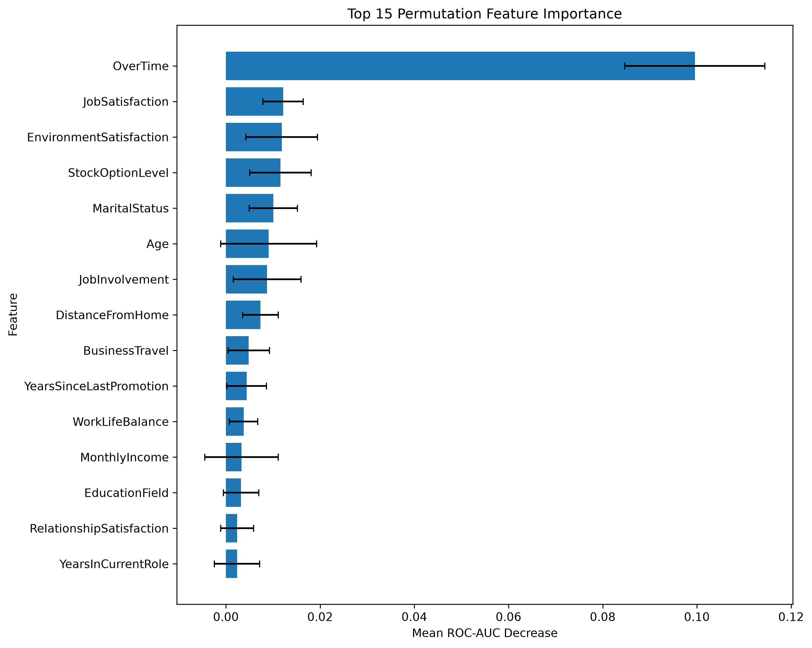
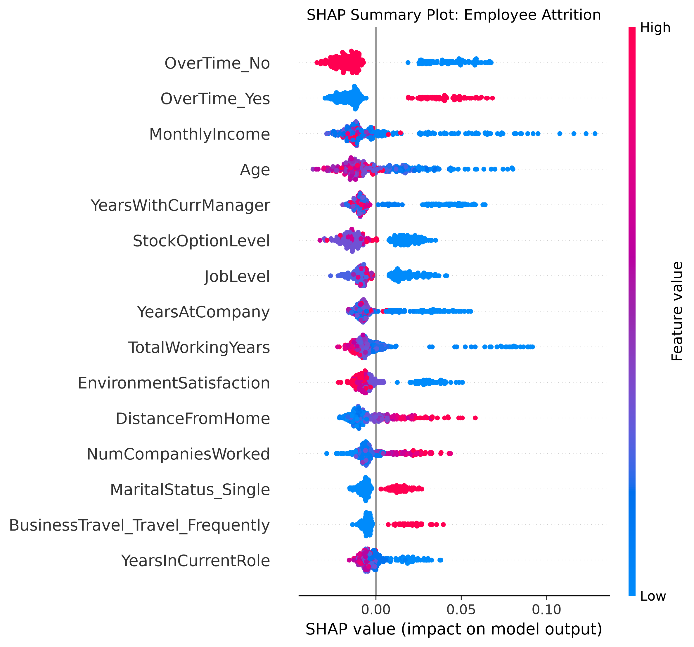
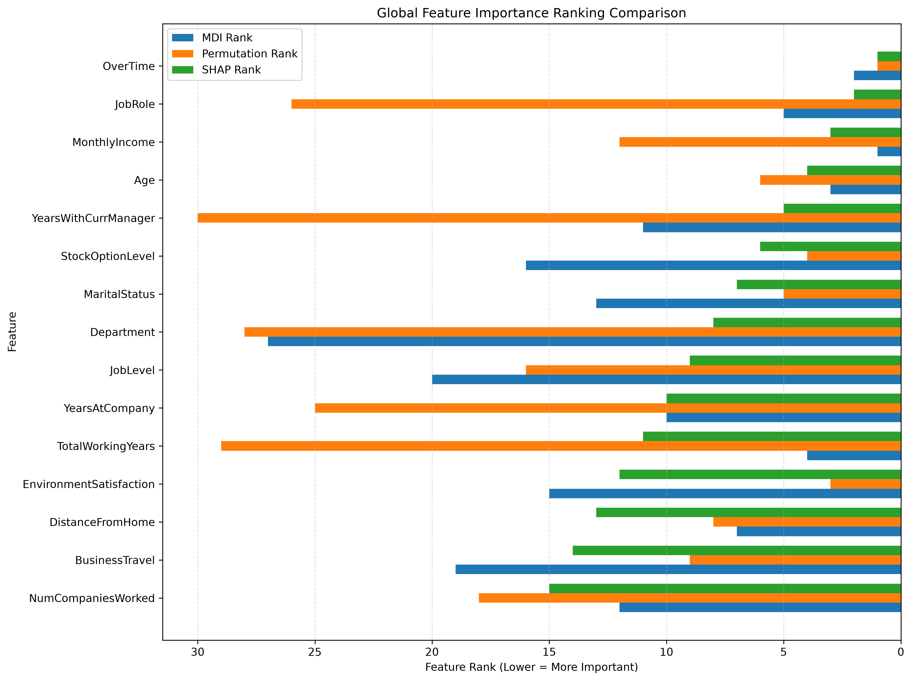
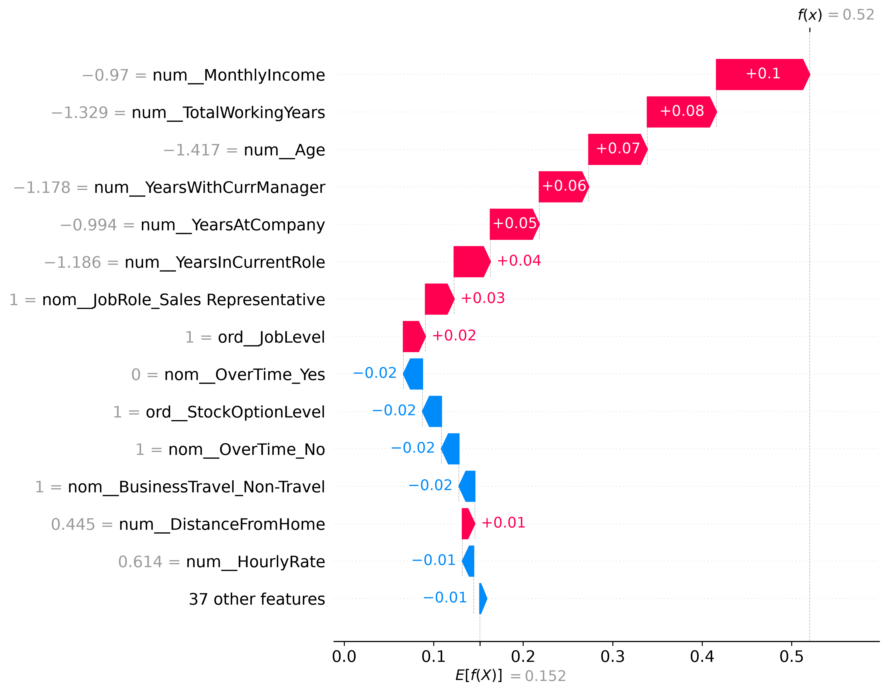

# WorkforceIQ: Model Explainability Report

## 1. Executive Summary

This report analyzes the predictive behavior of the WorkforceIQ employee attrition classification model.

The objective is to understand which employee features influence the model's predictions and how individual predictions can be interpreted using explainability techniques.

Three feature importance approaches were used:

- Mean Decrease in Impurity (MDI)
- Permutation Importance
- SHAP (SHapley Additive exPlanations)

These methods provide complementary perspectives on model behavior.

## 2. Model Overview

| Metric | Value |
|---|---:|
| Model | Random Forest Classifier |
| Test ROC-AUC | 0.8046 |
| Classification Threshold | 0.24 |
| Test Samples | 294 |
| Training Samples | 1176 |

The classification threshold was selected during Phase 5 model evaluation to improve attrition detection.

At the selected threshold:

| Metric | Value |
|---|---:|
| Precision | 44.62% |
| Recall | 61.70% |
| F1-score | 51.79% |
| Accuracy | 81.63% |

The model produces attrition probabilities, which are converted into binary predictions using the optimized threshold.

## 3. Global Feature Importance

### 3.1 Random Forest Feature Importance (MDI)

MDI measures the contribution of features to impurity reduction across the Random Forest.

The most prominent features include:

- MonthlyIncome
- Age
- TotalWorkingYears
- DailyRate
- DistanceFromHome

MDI importance is based on how the fitted trees use features during training.

### 3.2 Permutation Importance

Permutation importance evaluates how model performance changes when a feature is randomly shuffled.

ROC-AUC was used as the evaluation metric.

OverTime was the strongest feature according to permutation importance, with a mean ROC-AUC decrease of approximately 0.0996.

Other relatively important features included:

- JobSatisfaction
- EnvironmentSatisfaction
- StockOptionLevel
- MaritalStatus
- Age

Negative permutation importance values indicate that shuffling a feature slightly improved ROC-AUC on the evaluation dataset.

### 3.3 SHAP Global Importance

Global SHAP importance was calculated using mean absolute SHAP values.

The strongest transformed feature contributions included:

- OverTime_No
- OverTime_Yes
- MonthlyIncome
- Age
- YearsWithCurrManager
- StockOptionLevel

SHAP provides information about both contribution magnitude and direction.

## 4. Global Attrition Drivers

The following visualization compares feature rankings from MDI, permutation importance, and SHAP.

### Key observations

- OverTime consistently appears as a strong predictive signal.
- MonthlyIncome and Age are prominent in MDI and SHAP.
- StockOptionLevel and MaritalStatus have relatively high permutation and SHAP importance.
- JobRole has substantial SHAP contributions but comparatively low permutation importance.

Different importance methods measure different aspects of model behavior. Therefore, their rankings are not expected to match exactly.

## 5. Individual Employee Explanation

An individual employee from the test dataset was selected at test position 0.

| Attribute | Value |
|---|---:|
| Actual Attrition | No |
| Predicted Attrition | Yes |
| Attrition Probability | 0.52 |
| Classification Threshold | 0.24 |
| Prediction Outcome | False Positive |

The employee was classified as attrition-positive because the estimated probability exceeded the classification threshold.

### 5.1 Individual SHAP Explanation

The waterfall plot explains how individual feature contributions move the prediction away from the SHAP baseline.

### 5.2 SHAP Additivity Validation

| Metric | Value |
|---|---:|
| SHAP Base Value | 0.1516 |
| Reconstructed Probability | 0.5202 |
| Model Probability | 0.5200 |
| Additivity Difference | 0.000200 |

The SHAP explanation approximately reconstructs the model's predicted attrition probability.

### 5.3 Individual Feature Contributions

Positive contributors for the selected employee:

- MonthlyIncome
- TotalWorkingYears
- Age
- YearsWithCurrManager
- YearsAtCompany

Negative contributors:

- OverTime_Yes
- StockOptionLevel
- OverTime_No
- BusinessTravel_Non-Travel
- HourlyRate

Positive SHAP values increase the predicted attrition probability relative to the baseline. Negative SHAP values decrease it.

## 6. Key Findings

1. OverTime is a prominent predictive signal across multiple importance methods.
2. MonthlyIncome and Age contribute substantially to model behavior.
3. SHAP provides both global and employee-level interpretability.
4. Permutation importance measures the performance impact of feature shuffling.
5. Individual explanations help inspect why a model produces a particular prediction.

## 7. Limitations

- Feature importance does not establish causal relationships.
- SHAP contributions describe model behavior, not employee motivations.
- Correlated features can distribute or alter importance across methods.
- Permutation importance depends on the evaluation dataset and metric.
- The employee-level explanation represents one test observation and is not representative of all employees.
- Attrition predictions should not be used as definitive judgments about individual employees.
- The IBM HR Analytics dataset may not represent every organization's workforce or attrition patterns.

## 8. Conclusion

WorkforceIQ combines global feature importance and individual SHAP explanations to improve transparency of its attrition prediction model.

The explainability analysis identifies predictive signals, validates individual probability explanations, and provides a foundation for further model evaluation and responsible interpretation.

All findings describe predictive associations learned by the model rather than causal effects.
